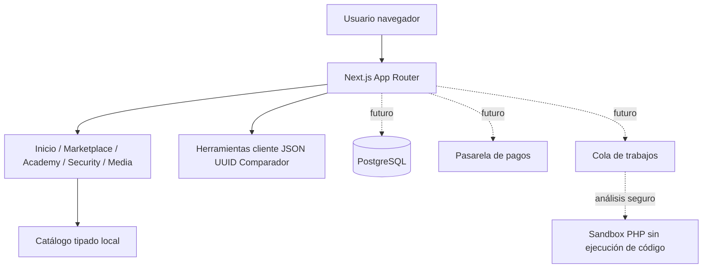

# Arquitectura DEVFORGE

## ADR-001: una aplicación Next.js TypeScript (aceptada)

Se elige un monolito modular en Next.js 16 App Router sobre microservicios para lanzamiento inicial. UI React, estilos Tailwind CSS 4, datos de catálogo tipados locales. Sin backend persistente en v0.1. Motivación: velocidad de entrega, mantenibilidad y costos reducidos.

## Seguridad
- Nunca ejecutar archivos PHP que suban clientes en el proceso web.
- Escaneo futuro: límite de tamaño y tipo, no seguir symlinks, aislamiento sin red por defecto, ejecución sin privilegios, cuotas de CPU/memoria, tiempo máximo, eliminación automática de datos, reglas SAST versionadas y trazabilidad.
- Autorización del propietario del código antes de revisar; proteger secretos y confidencialidad.
- No prometer detección completa de vulnerabilidades.

## Evolución
1. MVP: catálogo y páginas estáticas, utilidades client-side, contacto manual.
2. Versión comercial: PostgreSQL + auth server-side + pagos con webhooks idempotentes y verificación de firmas + licencias.
3. Contenido: MDX versionado y publicación de videoblog con plataforma externa.
4. PHP Shield: worker independiente, control de acceso, quotas, retención configurable.

## Observabilidad y calidad
- ESLint + TypeScript, pruebas de aceptación, CI para build.
- Antes de producción: tests de herramientas, navegación, formularios, rendimiento, SEO, accesibilidad y análisis de dependencias.
